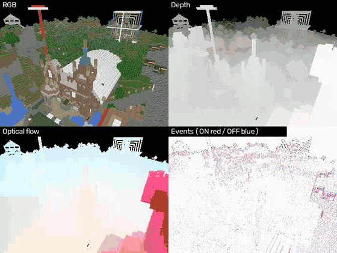
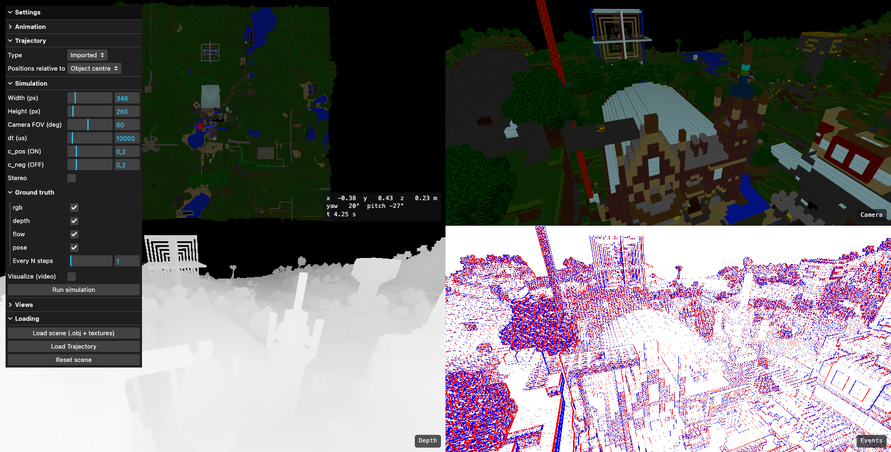
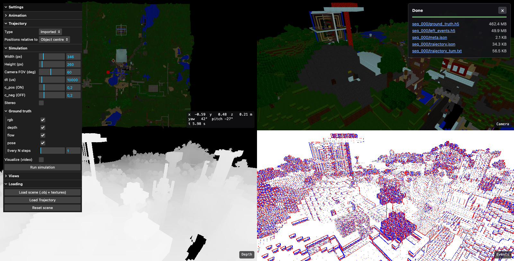

# Dynamic Vision Simulator (DVSim)

Simulates an event camera (DVS) moving through 3D scenes and produces **events** plus dense **ground truth**: RGB,
depth, optical flow and odometry (camera pose). It writes datasets to disk, is driven from a web interface, or
streams training clips straight into a PyTorch `DataLoader` (e.g. for spiking neural networks).

<p align="center">
  <br>
  <sub>One simulated sequence (346 x 260, 10 ms step): RGB, depth, optical flow and the event stream, all from the same pass.</sub>
</p>

## Features

**Simulation**
- Event camera model on the GPU-rendered luminance: ideal DVS by default (separate ON / OFF thresholds, every event of
  a large change emitted and timestamped inside the step) with optional threshold mismatch, refractory period,
  background noise and photoreceptor low-pass. Details in [Event camera model](#event-camera-model).
- Dense ground truth per frame: RGB, z-depth, forward optical flow with a validity mask, camera pose (also as a TUM file).
- Mono or stereo (second event stream and RGB from a camera offset along the camera's right axis).
- Microsecond timestamps relative to the trajectory start; configurable resolution, field of view and step.

**Scenes and trajectories**
- Scenes: `.obj` (with `.mtl` and several textures), `.glb`, `.gltf`, `.ply`, or a `SceneSpec` `.json` that places several
  objects with their own position, rotation and scale.
- Trajectories: recorded JSON paths, paths drawn in the web interface, paths recorded with an AR headset, or generated
  inside the scene: `rectilinear`, `spline`, and `street` (eye-height walks on open ground). Generation is fast: a voxel
  free-space grid keeps the camera out of the geometry. `street` walks can be played with learned human head motion
  (bob, sway, roll, gaze shifts): see [Human-like camera motion](#human-like-camera-motion).

**Ways to use it**
- `dvsim` command line: `demo`, `run`, `sample-scene`, `serve`, `info`, and `motion-import` / `motion-train` /
  `motion-eval` for human-like camera motion.
- Web interface (three.js): live previews of the camera, events, depth and optical flow, trajectory drawing and
  preview, background simulation jobs with progress and downloads.
- HTTP API (FastAPI) with background jobs, uploads, and WebSocket status.
- Live camera from a phone or an AR headset, with the simulator's own renderer streamed back to the phone.
- Dataloader mode: numpy `ClipStream` and a PyTorch `IterableDataset` that simulate on the fly, no files on disk.

**Outputs**
- `left_events.h5` (`right_events.h5`), `ground_truth.h5`, `trajectory_tum.txt`, `meta.json`, written incrementally with
  zstd compression, so long sequences never sit in RAM.
- Optional `mp4` previews: events, RGB, depth, optical flow (Middlebury colour code).

## Demo: a castle, from the interface

The scene is *Vokselia Spawn* (a Minecraft castle and its surroundings, 1.9M triangles). In the web interface, the
OBJ, MTL and texture are loaded in one selection, an orbit around the castle is imported (positions are relative to the object centre there), and the camera, event and
depth views follow it while it plays (the event view in the browser is a fast approximation of the simulator's):

<p align="center">
  
</p>

*Run simulation* then renders the same path with the real simulator. The panel shows the progress and links to the files
(here 6 s of 346 x 260 with all ground truth: 462 MB of `ground_truth.h5` and 50 MB of events):

<p align="center">
  
</p>

The GIF above comes from the same trajectory (`docs/media/castle_orbit.json`) run from the command line:

```sh
dvsim run --scene vokselia_spawn.obj --texture vokselia_spawn.png --trajectory docs/media/castle_orbit.json \
          --out out/ --gt all --visualize --width 346 --height 260
```

Scene: *Vokselia Spawn* by `vokselia`, from the [McGuire Computer Graphics Archive](https://casual-effects.com/data/),
licensed CC BY 3.0. It is not included in this repository.

## Install

Python 3.9 or newer and an OpenGL 4.1 driver (macOS, Linux with Mesa/EGL, Windows).

```sh
python -m venv .venv && source .venv/bin/activate
pip install -e ".[api]"          # core + web server;  add ,torch for the dataloader,  ,dev for the tests
dvsim info                       # checks that an OpenGL context can be created
```

## Try it (60 seconds, no input files)

```sh
dvsim demo                       # procedural room + trajectory -> data/demo/output/demo_000/
dvsim demo --stereo              # same with a stereo pair
```

`demo_000/` contains `left_events.h5`, `ground_truth.h5`, `trajectory_tum.txt`, `meta.json` and preview videos
(`viz_*.mp4`: events, RGB, depth, optical flow in the Middlebury colour code).

## Simulate your own scenes

```sh
# a scene file (.obj/.glb/.gltf/.ply), an optional texture, and recorded camera paths
dvsim run --scene room.obj --texture room.jpg --trajectory walk1.json walk2.json --out out/ \
          --width 346 --height 260 --dt-us 10000 --gt all --visualize

# random trajectories inside the scene (spline or rectilinear)
dvsim run --scene room.obj --texture room.jpg --generate spline --count 20 --duration 10 --out out/

# eye-height walks along streets / open floors (scene +Y up, in metres)
dvsim run --scene town.json --generate street --count 10 --duration 30 --walk-speed 1.4 --eye-height 1.6 --out out/

# several objects with their own transforms: a SceneSpec .json
#   {"objects": [{"path": "room.obj", "texture": "room.png"},
#                {"path": "chair.glb", "position": [1, 0, 2], "rotation_euler_deg": [0, 45, 0], "scale": 0.5}]}
dvsim run --scene scene.json --trajectory walk.json --out out/
```

Useful options: `--stereo`, `--gt rgb,depth,flow,pose|all|none`, `--gt-every N`, `--c-pos/--c-neg` (contrast
thresholds), `--sigma-c`, `--refractory-us`, `--shot-noise-hz`, `--lpf-cutoff-hz` (event-model noise, all off by
default), `--compression zstd|gzip|none`, `--config file.json` (a partial `SimConfig`). `dvsim run -h` lists everything.

**Trajectory files** are JSON lists of `{"timestamp": ms, "x", "y", "z", "rx", "ry", "rz"}` (a forward vector) or
`{..., "qx", "qy", "qz", "qw"}` (a full orientation). They can be recorded with the AR-headset page or drawn in the web
interface. Positions can be offset with `--origin X Y Z`.

## Human-like camera motion

`street` walks glide: constant speed, no roll. A small diffusion model can learn how people really move a head-mounted
camera and replay it on the planned path. The planner still keeps the camera out of the geometry; the model only adds
the motion of the person (bob, sway, roll, gaze shifts, speed changes). Needs PyTorch: `pip install -e ".[torch]"`.

```sh
# 1. collect recordings of people walking (one call per dataset; re-importing a name replaces that source)
dvsim motion-import tumrgbd tum /data/tum_rgbd --out corpus.npz        # TUM RGB-D groundtruth.txt files
dvsim motion-import aria aria /data/adt --out corpus.npz               # Aria / ADT closed_loop_trajectory.csv
dvsim motion-import mine headset recordings/ --out corpus.npz          # trajectories recorded with the AR headset

# 2. train (a GPU or Apple MPS is used when there is one); the model is stored as $DVSIM_DATA_DIR/motion/walk-v1.pt
dvsim motion-train --corpus corpus.npz --name walk-v1 --holdout-source mine

# 3. check it against the recordings it never saw (--scene also compares event rates and optical flow)
dvsim motion-eval --corpus corpus.npz --model walk-v1 --scene town.json

# 4. use it
dvsim run --scene town.json --generate street --motion walk-v1 --duration 30 --out out/
```

Each import prints a **heading agreement** per source: how well the camera looks where the person walks (1.0 for a
head-mounted camera on a walking person). A value below 0.5 means the dataset's frame was misread; fix it with
`--camera opengl|opencv` and `--up X Y Z`. Formats: `tum` (`t[s] x y z qx qy qz qw`), `aria`, `headset` (DVSim JSON) and
`csv` (`--layout tumvi | dvsim`). In the web interface the model appears as "Human motion" once the street generator
is selected; through the API it is `"motion": {"model": "walk-v1"}` on a `street` trajectory spec.

Limits: the model is conditioned on speed and turning only, so it does not choose where to go, and it was trained on
the speeds it saw (other speeds are clamped, with a warning). Training data decides the style: head-mounted glasses and
handheld cameras move differently.

## Web interface

```sh
cd frontend && npm install && npm run build && cd ..
dvsim serve                       # http://localhost:8000
```

- **Scene**: `Loading > Load scene` takes the `.obj`, its `.mtl` and the textures in one selection.
- **Trajectory**: draw it on the overview (left-drag), import a JSON file, ask the simulator to generate paths and
  preview them, or follow a phone / headset live.
- **Views**: the overview stays top-left; the three other quadrants show the camera, events, depth or optical flow.
- **Simulation panel**: size, field of view, step, contrast thresholds, stereo, which ground truth to save, video; then
  *Run simulation*. Jobs run in their own process; progress, cancel and downloads are in the panel.

For frontend development run `dvsim serve` and `npm run dev` (port 3000, proxies to the API). The AR-headset and phone
pages need HTTPS: put `key.pem` / `cert.pem` in `ssl/` and start `dvsim serve` with
`--ssl-keyfile ssl/key.pem --ssl-certfile ssl/cert.pem`. See [`frontend/README.md`](frontend/README.md) for every
control, including the phone as a live camera.

## Dataloader mode (no files on disk)

```python
from backend.dataloader import DVSimIterableDataset, make_dataloader

ds = DVSimIterableDataset(["room.obj", "office.glb"], {"camera": {"width": 128, "height": 96}},
                          clip_steps=10, gt=("depth", "flow"), samples_per_epoch=2000, seed=0)
loader = make_dataloader(ds, batch_size=8, num_workers=2)      # spawned workers, each owns a simulator
for batch in loader:
    spikes = batch["events"]         # (B, T, 2, H, W): one bin per 10 ms step, ON/OFF channels
    flow = batch["gt"]["flow"]       # (B, G, 2, H, W), aligned with the bins
    if batch["meta"]["is_first_clip"].any():
        ...                          # a new sequence starts: reset your network state
```

Clips are temporally contiguous slices of random trajectories generated inside each scene. Representations:
`count_frames`, `voxel`, `raw`. Without torch use `backend.dataloader.ClipStream` (numpy). Try
`python -m backend.dataloader`.

## Event camera model

An event camera has no frames: each pixel reports a signed event when the logarithm of the light it receives has
changed by a fixed contrast threshold since that pixel's last event. DVSim reproduces this in four stages, one per
simulation step `dt` (default 10 ms).

**1. Scene radiance.** The scene is static and unlit: every surface radiates its albedo, so the image is the texture
(or vertex / material colour) as seen from the camera. The GPU samples the sRGB texture, converts it to linear light
(filtering and mipmapping happen in linear space) and computes the linear luminance with the Rec.709 weights,

$$L = 0.2126\,R + 0.7152\,G + 0.0722\,B \in [0, 1].$$

Brightness changes in the image therefore come from camera motion only: parallax, occlusion, and texture moving across
pixels. There are no moving lights, shadows or specular effects.

**2. Log intensity.** Each pixel works on $\ell = \ln(L + \varepsilon)$ with $\varepsilon = 10^{-3}$ (`log_eps`), which
keeps black pixels finite. This is the sensor's logarithmic photoreceptor. With the default threshold, going from
black to white spans $\ln(1001) \approx 6.9$ log units, about 34 events.

**3. Event generation.** Each pixel keeps a reference level $r$, the log intensity at its last event. At step $k$,

$$d = \ell_k - r, \qquad n = \left\lfloor \frac{|d|}{C} \right\rfloor, \qquad C = \begin{cases} C^+ & d > 0 \;\text{(ON, } p = 1)\\ C^- & d < 0 \;\text{(OFF, } p = 0)\end{cases}$$

and the pixel emits $n$ events of that polarity, then moves its reference, $r \leftarrow r + \operatorname{sign}(d)\,n\,C$.
The remainder stays in the pixel, so slow changes accumulate until they cross a threshold. The $j$-th event
($j = 1 \dots n$) is timestamped by linear interpolation of the log intensity between the two frames,

$$t_j = t_{k-1} + \frac{j\,C}{|d|}\,(t_k - t_{k-1}),$$

rounded to whole microseconds. A burst is never dropped: a jump of 2.2 log units gives 11 events at $C = 0.2$, spread
over the step, not one event stamped at its end. Events of one step lie in $(t_{k-1}, t_k]$ and the stream is sorted by
time (ties in raster order), so consecutive steps concatenate into a globally sorted stream. The first frame only
initialises the references and produces no events.

**4. Output.** Events are `(t, x, y, p)`: time in microseconds relative to the trajectory start, pixel coordinates, and
polarity (1 = ON, brighter; 0 = OFF).

### Parameters

| Parameter (`EventConfig`) | CLI | Default | Meaning |
|---|---|---|---|
| `c_pos`, `c_neg` | `--c-pos`, `--c-neg` | 0.2 | ON / OFF contrast thresholds, in natural-log units (0.2 is a 22 % change in luminance) |
| `log_eps` | | 1e-3 | offset inside the logarithm |
| `sigma_c` | `--sigma-c` | 0 (off) | threshold mismatch between pixels |
| `refractory_us` | `--refractory-us` | 0 (off) | dead time of a pixel after an event |
| `shot_noise_hz` | `--shot-noise-hz` | 0 (off) | background activity rate per pixel |
| `lpf_cutoff_hz` | `--lpf-cutoff-hz` | 0 (off) | photoreceptor bandwidth |
| `seed` | `--seed` | 0 | seed of every random draw |
| `dt_us` (`SimConfig`) | `--dt-us` | 10000 | rendering and event-update step |

### Non-idealities (all off by default)

- **Threshold mismatch.** Each pixel gets its own threshold $C_\text{pix} = C \cdot \max(1 + \sigma_c\,\mathcal{N}(0,1),\ 0.1)$,
  drawn once per sequence and independently for ON and OFF.
- **Refractory period.** After an event, a pixel is blind for `refractory_us`. Events that would fall inside the dead
  time are dropped without moving the reference, so a change that persists fires again once the pixel is ready: the
  pixel is rate-limited, not silenced.
- **Background activity.** Events appear at random pixels, times and polarities, at `shot_noise_hz` per pixel (a Poisson
  count per step). They do not touch the reference or the refractory state.
- **Photoreceptor low-pass.** The log intensity goes through a first-order filter before the comparison,
  $y \leftarrow y + (\ell - y)\,(1 - e^{-2\pi f_c\,\Delta t})$, which smooths fast changes the way a finite-bandwidth
  photoreceptor does.

Everything is deterministic given `seed`. In stereo, the left and right sensors are separate models (seeds `seed` and
`seed + 1`) with the same thresholds unless `events_right` is set.

### Limits of the model

- **Sampling.** Light is sampled once per step and interpolated linearly in log intensity. A pixel whose value goes up
  and down inside one step produces nothing. Choose `dt` so that image features move by about a pixel per step or
  less (check the flow video); smaller steps cost proportionally more time.
- **No optics or motion blur.** No lens, exposure or per-pixel latency beyond the optional low-pass.
- **Static, unlit scenes.** The camera is the only thing that moves, and the radiance is the albedo (see stage 1).
- **Constant thresholds.** The contrast threshold does not depend on the light level, and there are no hot pixels or
  per-pixel noise rates.

## Reading the output

```python
import h5py, hdf5plugin                         # hdf5plugin registers the zstd filter
with h5py.File("left_events.h5") as f:
    t, x, y, p = (f["events"][k][:] for k in "txyp")           # microseconds, pixels, 1 = ON / 0 = OFF
with h5py.File("ground_truth.h5") as f:
    gt = f["ground_truth"]
    depth, flow, rgb, pose = gt["depth"][:], gt["optical_flow"][:], gt["rgb_left"][:], gt["pose"][:]
```

| Quantity | Convention |
|---|---|
| time | microseconds, **relative to the trajectory start** (`t_offset_us` attribute gives the offset) |
| depth | z-depth along the optical axis in scene units, `0` = no surface |
| optical flow | forward flow in pixels `(dx right, dy down)` from frame `t` to `t + flow_dt_us`, on frame `t`'s grid; `flow_valid` marks meaningful pixels |
| RGB | uint8, RGB order |
| pose | `x y z qx qy qz qw`, camera to world, OpenGL camera (looks along -Z, +Y up); also written as `trajectory_tum.txt` |

The full contract is in [`docs/architecture.md`](docs/architecture.md).

## Development

```sh
pip install -e ".[api,torch,dev]"
python -m pytest -q              # GL tests skip cleanly when no OpenGL context is available
cd frontend && npm test
```

Layout: `backend/scene` (loading), `graphical_computation` (one-pass renderer: RGB, luminance, depth, flow),
`event_processing`, `trajectories`, `motion` (learned human motion), `simulator.py`, `pipeline.py`, `saving`, `vizualisation`, `api`, `dataloader`,
`samples`, `cli.py`; `frontend/` (Vite + three.js); `tests/`.

Release notes are in [`CHANGELOG.md`](CHANGELOG.md).
